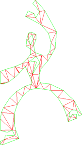

A lot of people have asked me: Why use a convex polygon only engine like Box2D? In this post I will
provide some info on why convex polygons are the optimal polygon type to use.

## What does convex mean?

[Convex polygons](https://en.wikipedia.org/wiki/Convex_polygon) need to satisfy the following
requirements:

- All internal angles must be below 180 degrees
- Every line segment between two vertices can be contained fully inside or at the edge of the polygon

<figure id="polygon-types" class="diagram diagram-panel vector-diagram" role="img" aria-label="Convex and concave polygons. A convex polygon has no inward dent. A concave polygon has at least one interior angle greater than 180°.">
    

        <svg xmlns="http://www.w3.org/2000/svg" viewBox="0 0 530 215" aria-hidden="true" focusable="false">
            <text x="115" y="24" text-anchor="middle" class="plot-label">Convex</text>
            <text x="415" y="24" text-anchor="middle" class="plot-label">Concave</text>
            <polygon class="polygon" points="12.00,130.00 94.00,46.00 152.00,46.00 215.00,108.00 130.00,193.00 34.00,168.00"/>
            <polygon class="polygon" points="322.00,92.00 390.00,46.00 472.00,46.00 510.00,111.00 448.00,170.00 435.00,129.00 371.00,164.00"/>
        </svg>
    

    <figcaption aria-hidden="true">A convex polygon has no inward dent. A concave polygon has at least one interior angle greater than 180°.</figcaption>
</figure>

A non-convex polygon is called a concave polygon and it must have an internal angle measuring
greater than 180 degrees. As you might have thought about yourself; concave polygons can be quite
handy. Convex-only engines can’t represent a simple player polygon like
[Pac-Man](https://en.wikipedia.org/wiki/Pac-Man).

## Why use convex-only?

There is really only one big juicy reason: **performance**

Physics engines are able to take quite a few shortcuts and use cheap algorithms to determine the
closest vertex, shortest distance and a lot more. Algorithms like [Separating Axis
Theorem](https://en.wikipedia.org/wiki/Separating_axis_theorem) and the [Gilbert – Johnson – Keerthi
(GJK)](https://www.google.dk/url?sa=t&source=web&ct=res&cd=3&url=http%3A%2F%2Fwww.cosy.sbg.ac.at%2F~held%2Fteaching%2Fbakk_seminar%2Fse_arbeiten_07-08%2FKollisionserkennungGJK.pdf&ei=qj-1SvCmI4ul4Qablql8&rct=j&q=GJK+algorithm&usg=AFQjCNFKqrM_oKLDo2rtjsMwyroi802FgA)
(pdf) both operate on convex polygons and provide fast, yet robust methods of getting
collision information. Fundamentally there are two great features of convex polygons:

- The existence of a separating plane between two non-colliding convex polygons
- When two points on two different geometries are at a minimum, they are at a [global
  minimum](https://en.wikipedia.org/wiki/Convex_function#Properties).

That might sound like gibberish for the layman. I’m not going to explain what those two
characteristics involve, but suffice to say that you can cut down on the complexity of the
algorithms used.

## Problems with using convex-only engines

From a performance point of view there are really no problems with using convex-only algorithms. The
problems that arise are mainly usability (ease of use and convenience for the users). If the user
supplies the engine with a concave polygon, all kinds of weird collisions will happen. A check is
needed to make sure the supplied polygon is of convex nature. But that topic is reserved for another
blog post.

The main approach for supporting concave polygons in a convex-only engine is described below.

### Convex decomposition

This method involves the use of either triangulation algorithms or algorithms that find a number of
convex polygons from a convex polygon. The idea behind convex decomposition is to simply split a
concave polygon into smaller convex polygons. This way a convex-only engine can support concave
polygons. A lot of algorithms exist to do this. To name a few:
[Earclip](https://en.wikipedia.org/wiki/Polygon_triangulation#Subtracting_ears_method), [Delaunay
triangulation](https://en.wikipedia.org/wiki/Delaunay_triangulation) and [Seidel’s triangulation
algorithm](http://www.gamedev.net/reference/articles/article408.asp).

Here is an example of a triangulated concave polygon using a [Constrained Delaunay
Triangulation](http://code.google.com/p/poly2tri/) algorithm.

[{width="169" height="299" loading="lazy" decoding="async"}](/assets/images/posts/967e00b46e8da0a85128.webp)