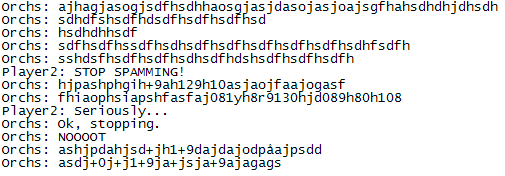

Let me ask you one thing: Why do network-enabled games utilize user controlled user management (like kick voting menus)?

The answer is really simple: *User management*

## User management

Network-enabled games need some kind of online-police that can control the game and its users.
Imagine a rogue user that joins an online game just to create havoc and chaos. I have met several
examples myself in my past as both server admin, game moderator and as a player. They all have one
thing in common: Make people angry and laugh at their inability to act on it. Let us have a look at
the different types of bad guys:

### The microphone guy

The first case is a user that connects his microphone, turns up his music (Usually obnoxious
repeating music designed to drive people crazy) and presses the “talk” button. This can continue the
whole game and it makes people furious. Players start to blame the game and game moderators that
they are not doing anything about it, but fact is that they are powerless. Once the trend has
started, not even an army of server admins can respond fast enough to prevent the damage.

### The message spammer guy

This one continues to spam the chat with messages of random characters. Games where the chat is
displayed onscreen with the rest of the HUD are the most vulnerable ones. A devious mind can easily
exploit the fact that the length of messages is only wrapped at the length of the screen. This
means that he can eventually fill up the whole screen with text and make other users unable to see
anything.

Example:

[{width="505" height="176" loading="lazy" decoding="async"}](/assets/images/posts/010f6720f73ea96e27f8.png)

### The foul mouth guy

The only purpose this guy has is to piss people off. He might not have bad intentions when starting
the game, but as soon as someone addresses him, he sees an opportunity of playing a dangerous game
of foul-mouthing. All kinds of bad words known to man are exchanged and if the game contains a
profanity filter, it also becomes an exercise of finding words that are not included in the game
blacklist.

### The newbie hater guy

Games should be equal toward all their users in the sense that they should not prefer experienced
users over new users. Once a newbie has achieved some kind of experience, he might feel better when
jumping on new players and make them feel stupid. This guy makes experienced users group together
and flame the new users and make them feel guilty. It can create a bad user experience and
eventually loss of players.

### The idle guy

This guy spawns in the game and then goes for a 15 minute toilet visit. The word “player” means that
the guy is playing – if he is not playing, then he is only in the way of other users. Imagine a line
at the supermarket where you have been standing for 10 minutes before you realize that the guy in
front of you suffers from narcolepsy and fell asleep while still standing up. (bad example, I know -
You get the point)

### The newbie general

This kind of guy really depends on the game. Some games contain a general or  commander seat where the
guy in that seat controls stuff other users can’t. A good example is the
[Savage](https://web.archive.org/web/20100106014643/http://www.savage2.com:80/en/main.php) game where the job of the commander is giving buffs like
heal, extra armor and giving negative buffs to the enemy. Each game 1 player gets to know how to
command and 10 players get experienced in fighting. This causes experienced commanders to become a
rarity. Once a new user is in the commander seat, the game might as well announce the other team as
the winners.

## The evolution of games

All the cases listed above have in common that they create a bad user experience, lessen the quality
of the game and fill up the forums with posts made by furious players. This is reflected in the
reputation of the game and the loss of users (and again loss of money).

The solution is quite simple: **User controlled user management.**

Since old times when the first popular network games started popping up, we have had bad guys. The
thing about being a bad guy is that there are no consequences for your actions. They might be kicked
if some users decide to report them, but the problem with that is that there might be hundreds of
users each day and the response time is not always great. Realizing this fact some games implemented
user controlled user management through voting menus and automatic filtering and checks.

Listing the different mechanisms:

- **Aggressive profanity detection**
    - Detect profanity and keep a statistic. Kick the user when too much profanity has been detected
      and remember to warn first.

- **User kick vote**
    - Users can initialize a kick vote towards a single user. This is useful in cases where automatic
      detection fails.

- **Text spamming detection**
    - Put in a delay after 3 rapid messages and double the delay time each time this rule is violated.

- **Microphone spamming detection**
    - Record the length of time spent on the microphone.

- **User kick/spamming history**
    - If a user is constantly getting kicked from servers or has a history of rule violations,
      investigate the case.

- **Idle player detection**
    - When a user has not moved for 1 minute, kick him.

- **Game specific limitations**
    - Like the case of newbie commander, make sure that new players are sufficiently experienced
      before giving them commander status.

The bottom-line is that players and their collective attitude towards the game together with
automatic “bad guy” detection is necessary to keep a game playable, we learned that through the
evolution of networked games. It is more important than you might imagine and so easy to prevent.