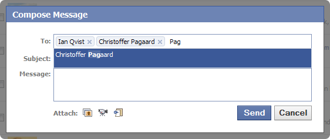

You might have seen the crispy AJAX enabled auto-complete list when entering friends into a textbox.
I was especially intrigued by the “Compose Message – To:” textbox. You enter a part of a name and
almost instantly a list of names pops up. Adding a name is as simple as selecting it from the list and
it gets added to the textbox.

[{width="562" height="237" loading="lazy" decoding="async"}](/assets/images/posts/dd470491add36b90528f.webp)

I started to identify the different parts of this functionality:

- Labels inside textbox
- Auto-completion on entering text
- Growable textbox size
- Highlighting of results
- Close button on labels
- Many more…

It looked like a daunting task, so I decided to search for an already made solution instead of
making one myself. I came across an [Ajax Control Toolkit
issue](https://web.archive.org/web/20101006025456/http://ajaxcontroltoolkit.codeplex.com:80/workitem/18534?) that requested
this functionality and even a [jQuery plugin mentioned on Stack
Overflow](http://stackoverflow.com/questions/210308/nice-labels-with-x-in-to-field-of-compose-message).
Seemed like a lot of people mentioned this functionality, but nothing really appealed to me until I
found [TextboxList on DevThought.com](http://devthought.com/projects/mootools/textboxlist/).

It immediately caught my attention since it had a working demo that was exactly what I wanted. The
greatest thing about TextboxList is that it is simple and very extensible, so I started my journey
to create a To: field like the one from Facebook.

## ASP.net implementation

I’m working in ASP.net with C# and the demo provided by DevThought.com was PHP only. Since I have a
past of PHP, I decided to quickly take a look at their demo and create an ASP.net clone.

The only thing I did was to convert the auto-completion to C#. Everything else has just been taken
from the original demo and fitted into a simple web site project. You can download the source code
here:

[Download TextboxList ASP.net
Demo](http://cid-f116593ba64184a2.skydrive.live.com/self.aspx/.Public/TextBoxListASP.net.zip)