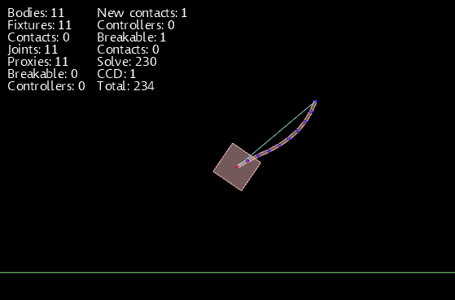

I’ve just packaged and released Farseer Physics Engine 3.1. It has a lot of new features and a
couple of bugs have been fixed. You can see a list of changes in the new version on the [downloads
page](https://web.archive.org/web/20110130092106/http://farseerphysics.codeplex.com:80/releases/view/51080).

[{width="559" height="369" loading="lazy" decoding="async"}](/assets/images/posts/dbf03dc8ec984d7c3b37.webp)