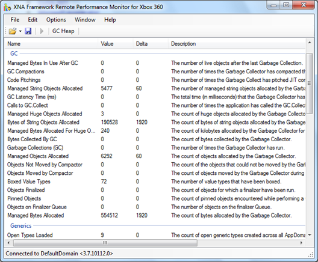

After my [Performance Tips and Tricks](/2010/01/performance-tips-and-tricks-series.html) series I
got a lot of requests to write a post regarding the performance on the Xbox 360 platform. I will try
to focus on why Xbox 360 is slower than PC and what we can do to get around it. But first we need to
underline the importance of good programming.

## Algorithms and data structure complexity

I’ve been on the topic of complexity [before](/2010/07/big-o-notation-summary.html). I can’t
underline how important it is that we keep the complexity of our algorithms low. If you are sorting
a large dataset, make sure you use the [correct](https://en.wikipedia.org/wiki/Quicksort) algorithm
and if you are sorting a small dataset (\<10 items), there is [another and
faster](https://en.wikipedia.org/wiki/Insertion_sort) algorithm.

**Note:** If you use .Net [List\<T\>.Sort()](https://learn.microsoft.com/en-us/dotnet/api/system.collections.generic.list-1.sort?view=net-10.0&redirectedfrom=MSDN),
it automatically chooses the best algorithm depending on your dataset.

If you are using pixel perfect collision detection, perhaps you should implement a physics system
that uses a polygon collision system instead. You could also implement a [broad
phase](/2010/07/broad-and-narrow-phase-collision.html) system to filter out collisions that you
don’t need to process. Implementing a fast and efficient algorithm is 100 times better than any
micro-optimization or performance trick out there. But this post is not about using efficient
algorithms, it is about the case where you already have implemented the algorithms and still need to
squeeze the last drops of performance out of the platform.

## Why is it slow?

Xbox 360 uses a custom
[triple-core](https://en.wikipedia.org/wiki/Xbox_360_hardware#Central_processing_unit) 64bit PowerPC
3.2 GHz CPU. It is designed by IBM with high floating point performance in mind by using multiple
FPUs and SIMD vector processing units in each core. It is quite a powerful platform, but an
equivalent PC still outperforms it, how can that be?

I’m afraid that the hardware is not the problem here, it is the software on the Xbox 360. Let us
take an example; the following piece of code measured 12500 ticks on Xbox 360 and 10 ticks on PC.
The result is unused and repeated doubling overflows `float`, so this illustrates the tested
compiler behavior rather than sustained floating-point throughput.

```csharp
float t = 1;
for (int i = 0; i < 10000; i++)
{
    t *= 2;
}
```

That is a huge difference and even if we switch to integers instead of floats (to get around the
[FPU](https://en.wikipedia.org/wiki/Floating-point_unit)) we still get around 7060 ticks on Xbox 360
and 10 ticks on PC. The low performance when using floats is due to missing
[AltiVec](https://en.wikipedia.org/wiki/AltiVec) support in .Net Compact Framework and some missing
optimizations in the floating point code. The .Net Compact Framework was not designed to run on Xbox
360\. In fact, it was designed with portability in mind and did not have any floating point code
until the Xbox was released. Thankfully the .Net CF team implemented some FPU code and that improved
the floating point performance a lot (by a factor of 10!).

Then there is the garbage collector. The CF has a simplified version of the garbage collector that
works without
[generations](https://en.wikipedia.org/wiki/Garbage_collection_%28computer_science%29#Generational_GC_.28ephemeral_GC.29).
Instead it looks up all the objects after 1 MB has been
[allocated](https://learn.microsoft.com/en-us/archive/blogs/stevenpr/an-overview-of-the-net-compact-framework-garbage-collector).
There are also a few other differences such as code pitching where the GC frees code it has jitted
before to free up memory. And last but not least there are the compiler optimizations performed by
the CF [JIT](https://en.wikipedia.org/wiki/Just-in-time_compilation) compiler. The optimizations
carried out by the CF JIT are severely limited, especially the method inlining. The CF JIT will only
inline a method based on the following criteria for the Compact Framework version discussed here:

- 16 bytes or less of IL
- No branching (if statements)
- No local variables
- No exception handlers
- No 32-bit floating point arguments or return value
- If it has more than one argument, they must be accessed in order from lowest to highest.

That means it basically only inlines property getter/setters and methods that call other methods.

The missing FPU code, the few optimizations and the simple garbage collector are all because the CF
never was designed to work on anything else but embedded devices such as mobile phones. Lets take a
look at what options we have…

## Optimizing the code

It is very important that you start by
[profiling](https://shawnhargreaves.com/blog/why-measure-when-you-can-guess.html)
your code. You can use the [XNA Remote Performance
Monitor](https://learn.microsoft.com/en-us/previous-versions/windows/xna/bb200104(v=xnagamestudio.41)?redirectedfrom=MSDN) to profile memory allocations
(garbage collector problems) and you can use the
[Stopwatch](https://shawnhargreaves.com/blog/profiling-with-stopwatch.html) class
to profile different areas of your code to see which area you should focus on. A normal PC profiler
also comes in handy as the areas that tend to take up the most time on PC, almost always are the
same areas on the Xbox 360.

[{width="528" height="436" loading="lazy" decoding="async"}](/assets/images/posts/df3289be97ab52bdd1a4.webp)

When you have found the different areas to focus on, we can move on to actually optimizing them.

### `virtual` methods

One of the places to optimize are the `virtual` methods and properties. While virtuals are great for
[OOP](https://en.wikipedia.org/wiki/Object-oriented_programming), they are not so great for the CF
JIT compiler. `virtual` calls can add dispatch overhead, depending on the call site, and can prevent
inlining by the Compact Framework JIT discussed here.

```csharp
// Before
public class Unit
{
    public virtual void MyVirtualMethod()
    {
    }

    public virtual bool GetProperties { get; set; }
}

// After
public class Unit
{
    public void MyVirtualMethod()
    {
    }

    public bool GetProperties { get; set; }
}
```

To get around it you need to avoid virtuals where you can. If you need to use virtuals, make sure
you mark your overridden methods and classes as
[`sealed`](https://learn.microsoft.com/en-us/dotnet/csharp/language-reference/keywords/sealed). If you use the `sealed`
keyword, the compiler can sometimes resolve the destination of a `virtual` call and avoid the
expensive `virtual` call.

### Use fields instead of properties

While properties are a neat way to keep your code clean, they are not that great performance wise.
Under the hood, properties are ordinary methods and while simple get/set properties get inlined by
the compiler, there are no guarantees that all of them will get inlined. The solution is to use
fields instead, but not at the cost of a poorly designed application. So use it wisely!

```csharp
// Before
public class Unit
{
    public int HitPoints { get; set; }
}

// After
public class Unit
{
    public int HitPoints;
}
```

### The `ref` keyword

If you are working with [structs](https://learn.microsoft.com/en-us/dotnet/csharp/language-reference/builtin-types/struct),
you should try and use the [`ref` keyword](https://learn.microsoft.com/en-us/dotnet/csharp/language-reference/keywords/ref) to
send them by reference instead of by value. If you are working with the XNA library, the Matrix,
Vector2 and Vector3 classes have math methods that use `ref` and
[`out`](https://learn.microsoft.com/en-us/dotnet/csharp/language-reference/keywords/out) to pass structs by reference
instead of by value.

```csharp
// Before
public class Unit
{
    public Vector2 Position = new Vector2(10, 5);

    public Vector2 Move(Vector2 delta)
    {
        return Position + delta;
    }
}

// After
public class Unit
{
    public Vector2 Position = new Vector2(10, 5);

    public void Move(ref Vector2 delta, out Vector2 r)
    {
        Vector2.Add(ref Position, ref delta, out r);
    }
}
```

### Inlining

Manually inlining code when using the Compact Framework can give you an extra performance boost. The
gain is typically around 5-15% depending on your code. The tricky part of inlining is to determine
what code to inline. I recommend you follow some simple rules:

- Small methods
- Methods that are only called from one place
- Methods that do not alter the state of the object (only give input and get output methods)
- Methods that do not already get inlined by the compiler

It is important to run a profiler while you inline. You might get even worse performance by inlining
the wrong methods. It is important to measure it!

```csharp
// Before
public class Unit
{
    public Vector2 Position = new Vector2(10, 5);

    public void Move(ref Vector2 delta, out Vector2 r)
    {
        Vector2.Add(ref Position, ref delta, out r);
    }
}

// After
public class Unit
{
    public Vector2 Position = new Vector2(10, 5);

    public void Move(ref Vector2 delta, out Vector2 r)
    {
        r = Vector2.Zero;
        r.X = Position.X + delta.X;
        r.Y = Position.Y + delta.Y;
    }
}
```

### Pooling

In the [CLR](https://en.wikipedia.org/wiki/Common_Language_Runtime), creating an object is a really
[efficient](https://web.archive.org/web/20110123174249/http://vineetgupta.spaces.live.com/blog/cns!8DE4BDC896BEE1AD!1104.entry) operation while
destroying the object is not. This is due to the fact that destroying an object will make it subject
to the garbage collector. A way to get around this is to use
[pooling](https://en.wikipedia.org/wiki/Object_pool_pattern) of objects. You basically create a pool
(you could use a [stack](https://learn.microsoft.com/en-us/dotnet/api/system.collections.stack?view=net-10.0&redirectedfrom=MSDN)) and
then pre-allocate a bunch of empty objects before use. When you need an object, you fetch one from
the pool and when you are done with it, you put it back in the pool. This way the pool keeps the object reachable so it survives garbage collection and can be reused.

### Fixed point math

I’ve been on this [subject before](/2009/10/floating-and-fixed-point-arithmetic.html). If you have
some heavy floating point operations that you need to run on a platform with low floating point
performance, then you should implement fixed point math. A trick is to identify operations that
don’t need floating point accuracy (like my code above in the explanation) and convert it to use
integers instead.