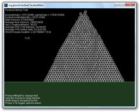
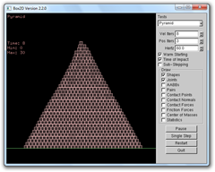
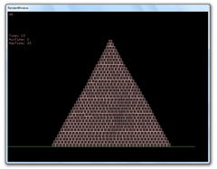
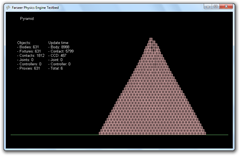

With the help of Paril - the developer of [Box2C](https://code.google.com/archive/p/box2c) - I've made a
benchmark of the following engines:

- [jBox2D](https://jbox2d.org/) rev 261 trunk
- [Box2D](https://box2d.org/) 2.2
- Box2D 2.1.2
- Box2C rev 20 (wrapper for Box2D 2.1.2)
- [Farseer Physics Engine](https://github.com/Genbox/VelcroPhysics) 3.2

I was quite surprised by the findings, so I decided to post them here.

I benchmarked the different engines using the Pyramid test from the Box2D Testbed. We used a pyramid
base count of 35 that resulted in 630 stacked boxes at once. We found that higher base count
resulted in too much breakup in the pyramid in the engines based on Box2D 2.2. I started the tests
and waited for the solver to converge and the timer output became steady. I repeated this several
times to make sure the results were consistent.

## Test system

2 x Quad core Xeon 2.33 Ghz 1333 Mhz FSB  
6 Gb FBDIMM RAM  
Geforce 7900 GT 256 Mb RAM

Running Windows 7 64Bit with as few applications as possible.

## Box2D Settings

Velocity iterations: 8  
Position iterations: 3  
CCD: Enabled  
Sleeping: Disabled  
Warmstarting: Enabled

Rest of the settings are the Box2D defaults.

## Results

### jBox2D rev 261 trunk (Fastmath = false to the right)

[{width="240" height="192" loading="lazy" decoding="async"}](/assets/images/posts/f498d5bb7cdfcb5fcb56.webp) [{width="240" height="192" loading="lazy" decoding="async"}](/assets/images/posts/020fca69d443c4f71ee7.webp)

### Box2D 2.2

[{width="240" height="192" loading="lazy" decoding="async"}](/assets/images/posts/4f3f587237ca3248c846.webp)

### Box2D 2.1.2

[{width="240" height="192" loading="lazy" decoding="async"}](/assets/images/posts/2f537213cce4438914f6.webp)

### Box2C rev 20

[{width="240" height="187" loading="lazy" decoding="async"}](/assets/images/posts/8191ef36e6bfe58a42f6.webp)

### Farseer Physics Engine 3.2

[{width="240" height="156" loading="lazy" decoding="async"}](/assets/images/posts/12b2b3704e0ecffa770a.webp)

| Engine:                    | Time     | Notes                                                                                                                                                                                                                                                                                          |
|----------------------------|----------|------------------------------------------------------------------------------------------------------------------------------------------------------------------------------------------------------------------------------------------------------------------------------------------------|
| jBox2D rev 261             | 11/12 ms | Unstable pyramid when fastmath was set to true – I clocked it at 11 ms. Some boxes fell of the top and fell outside the screen. With fastmath = false, the simulation was a bit more stable, but also a bit more wobbly. Turing off fastmath resulted in 1 ms slower simulation (total: 12 ms) |
| Box2D 2.2.0                | 8 ms     |                                                                                                                                                                                                                                                                                                |
| Box2D 2.1.2                | 10 ms    | Simulation seems more rigid than Box2D 2.2.0 and the pyramid looks perfect.                                                                                                                                                                                                                    |
| Box2C rev 20               | 13 ms    | 3 ms slower because of the overhead of being a C# wrapper.                                                                                                                                                                                                                                     |
| Farseer Physics Engine 3.2 | 6 ms     |                                                                                                                                                                                                                                                                                                |

## Conclusion

Farseer Physics Engine 3.2 is by far the fastest of the engines, which might seem a little odd
considering it is a direct port of Box2D 2.2.0 and written in C#. However, due to the heavy manual
optimizations done to the collision system, it manages to be even more efficient than the original
Box2D library. I’m not sure how different jBox2D is from Box2D 2.2 seeing as it produces different
results from the rest of the engines, but 11-12 ms is a pretty good result considering it is written
entirely in Java.