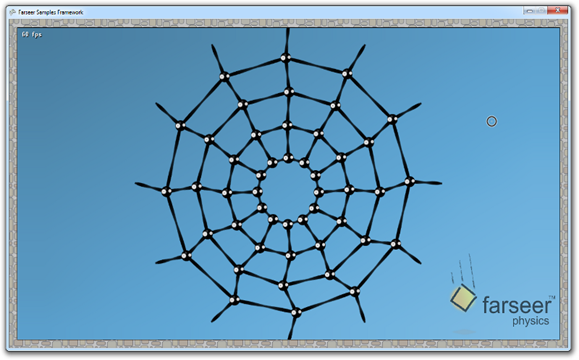

The PowerPoint slides and XNA HelloWorld application from my talk at ITU can be found
[here](https://skydrive.live.com/redir.aspx?cid=f116593ba64184a2&resid=F116593BA64184A2%21274&parid=F116593BA64184A2%21210&authkey=%21AL_M6wo5DDLqTyw).

[{width="579" height="360" loading="lazy" decoding="async"}](/assets/images/posts/03da5d16a4cc74ee2998.webp)

Thanks to Joe Kiniry for lending me a room to do the presentation.