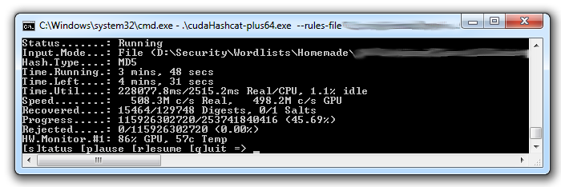

After reading an [analysis of the leaked Stratfor password
hashes](https://web.archive.org/web/20130115165359/http://www.thetechherald.com/articles/Report-Analysis-of-the-Stratfor-Password-List)
elsewhere, I got inspired to do an analysis myself. I was rather surprised by the fact that the
report only cracked 81,833 passwords in 4 hours and 53 minutes, so I decided to do a bit of cracking
on my own. I did it mainly to see if I could get a more complete view of the passwords used in the
Stratfor database.

Over the past years I have gathered a good amount of data and knowledge about how users get around
password policies. I'm not going into detail on the Stratfor password policy, as it is already
mentioned in the article linked above, but suffice to say, Stratfor, like so many others, has a weak
password policy, that makes hashing the passwords almost useless in terms of cracking.

## The Wordlists

Some wordlists are freely available, such as the widely known
[JohnTheRipper](https://www.openwall.com/john/) wordlist or the one packaged with [Cain and
Able](https://oxid.it/en-gb). The creators of JohnTheRipper even have a public listing of [free
wordlists](ftp://download.openwall.net/pub/wordlists/), however, the wordlists are designed to give
you access to passwords very quickly and thus, they are very small and not very 'complete'. Larger
wordlists can be found scattered around the Internet, but they are generally of low quality and most
of the time contain garbage that has no resemblance to passwords. There are some better quality
wordlists out there, some are free, some are not, but when all is said and done, it is always better
to create your own custom wordlists.

Being very eccentric in the field, I have created my own wordlist based on huge amounts of data from
the Internet. My personal wordlist is a whopping 14.6 GB and is based on about 5000 smaller
wordlists and other data sources. Without duplicates, a password length max of 25 and sorting it
according to word frequency makes it very efficient when used in combination with a GPU. I will post
more details later on how to create a good wordlist.

{width="700" height="234" loading="lazy" decoding="async"}

Hashcat-Plus working on a wordlist

## Rules

Some cracking applications can apply rules to passwords, this is also sometimes referred to as word
mangling. It is the process of taking a password and applying some sort of transformation to it. I've
listed some of the common rules used with "password" as the example:

- Uppercase first char - result: Password
- Append 1 - result: password1
- Duplicate word - result: passwordpassword
- Prepend ! - result: !password

Efficient rules can make your wordlist 10 times more efficient without using more space, at the cost
of a little more time. Running all my wordlists with a custom rule-set took about 5 hours.

## Brute Force

The effectiveness of brute forcing hashes depends on the password search space, the hashing
algorithm and the available hardware. The Stratfor password
policy is one of many that has a weak policy, and thus, brute force can be used against the password
hashes. Having a good strategy for what set of characters to use is essential to lower the time it
takes to brute force hashes. I chose to go all out and crack all hashes from 1-8 characters in
length in both uppercase, lowercase and digits. I also did digits up to 12 in length and symbols
only up to 10 in length. The total time spent on brute force is 3 days and 14 hours without
optimizing hashcat to use the full potential of my graphics card.

## The Results

The Stratfor leak contained 860,160 hashes and a total of 746,324 of them were cracked. That is a
whopping 86.76% of the hashes!

### Length distribution

```chart
id: stratfor-length
type: "columns"
note: "Share of cracked passwords"
x_label: "Characters"
data: [["≤ 7", 9.27], ["8", 86.76], ["≥ 9", 3.98]]
```

Average password length: 7.907926

### Character distribution

```chart
id: stratfor-characters
type: "bars"
note: "Share of character types across all passwords"
decimals: 0
max: 100
data: [["Lowercase letters", 39], ["Uppercase letters", 33], ["Symbols", 1], ["Digits", 27]]
```

### Contained in common wordlists

```chart
id: stratfor-wordlists
type: "split"
note: "Share of cracked passwords"
decimals: 0
data: [["In wordlists", 10], ["Not in wordlists", 90]]
```

### Top 30 most common passwords

| Password     | Frequency |
|--------------|-----------|
| `stratfor`   | 12023     |
| `123456`     | 625       |
| `0`          | 519       |
| `password`   | 517       |
| `stratfor1`  | 426       |
| `changeme`   | 265       |
| `strat4`     | 265       |
| `1qaz2wsx`   | 232       |
| `1234`       | 228       |
| `wright`     | 179       |
| `usmcportal` | 148       |
| `abc123`     | 89        |
| `qwerty`     | 85        |
| `12345`      | 75        |
| `12345678`   | 74        |
| `Stratfor`   | 71        |
| `iloveyou`   | 56        |
| `research`   | 53        |
| `qqq111`     | 53        |
| `STRATFOR`   | 50        |
| `letmein`    | 47        |
| `password1`  | 46        |
| `capgroup`   | 45        |
| `stratfor09` | 44        |
| `111111`     | 44        |
| `charlie`    | 44        |
| `wgint`      | 43        |
| `baseball`   | 43        |
| `ranger`     | 42        |
| `trustno1`   | 42        |

### Top 30 longest passwords

| Password                     | Length |
|------------------------------|--------|
| `QWERTYUIOPASDFGHJKLZXCVBNM` | 26     |
| `1q2w3e4r5t6y7u8i9o0p-[=]`   | 24     |
| `bhooshaniyer@gmail.com`     | 22     |
| `darrenrose@gmail.com`       | 20     |
| `stratfor10stratfor10`       | 20     |
| `vanderleun@gmail.com`       | 20     |
| `/,password/,password`       | 20     |
| `1234567890qwertyuiop`       | 20     |
| `huddersfield@msn.com`       | 20     |
| `Hawkeye00@gmail.com`        | 19     |
| `Whereiseverybody007`        | 19     |
| `abc1234@hotmail.com`        | 19     |
| `1234567891011120000`        | 19     |
| `laurallie@gmail.com`        | 19     |
| `jashburn@gmail.com`         | 18     |
| `theenemy@gmail.com`         | 18     |
| `dontforgetpassword`         | 18     |
| `horatio hornblower`         | 18     |
| `tsuki777@gmail.com`         | 18     |
| `ctannery@gmail.com`         | 18     |
| `international1007`          | 17     |
| `heiling@yandex.ru`          | 17     |
| `scheidt@gmail.com`          | 17     |
| `tisma@hotmail.com`          | 17     |
| `lumpenproletariat`          | 17     |
| `stratfor1stratfor`          | 17     |
| `bandofbrothers007`          | 17     |
| `ghostinthemachine`          | 17     |
| `Nachrichtendienst`          | 17     |

## Notes

It struck me that almost all (86.76%) of the recovered passwords were 8 characters long. A more uniform distribution
is normally found in password databases.