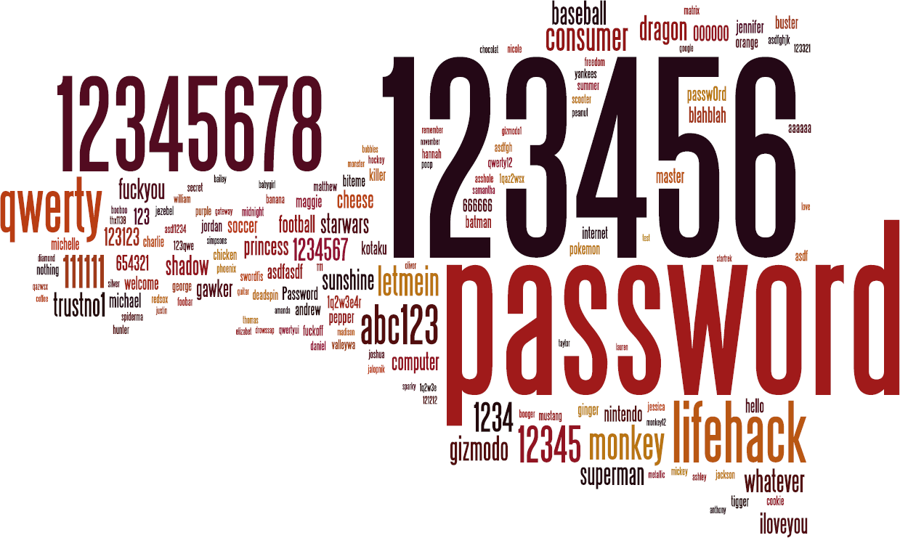

Combining passwords from the 4 leak analyses I've posted so far, the following frequency, from a
total of 1.185.557 passwords, looks something like this:

{width="1239" height="741" loading="lazy" decoding="async"}

Right-click the image and choose "View Image" to see a larger version.

You can read the analyses of
[Stratfor](/2012/01/analysis-of-leaked-stratfor-password.html), [B-K
Lightning](/2012/01/analysis-of-leaked-b-k-lightning.html), [Cancao
Nova](/2012/01/analysis-of-cancao-nova-leak.html) or
[Gawker](/2012/01/analysis-of-gawker-leak.html) to see more details about
the password frequencies.