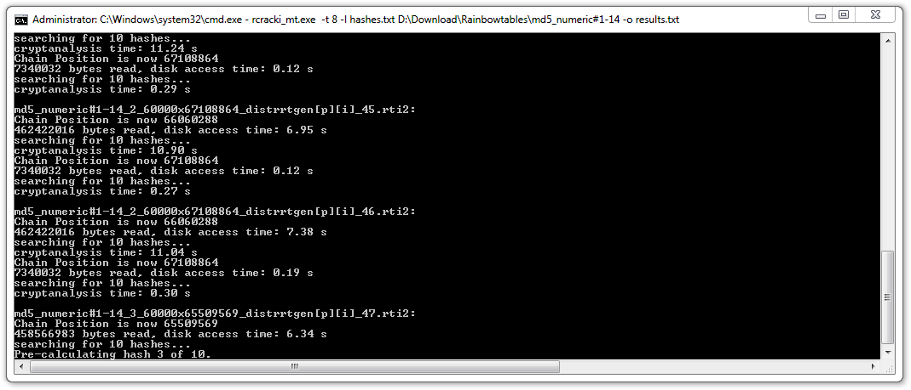

So far I've covered [how to build the perfect
wordlist](/2012/01/building-perfect-wordlist.html). Now it is time to
take a look at [rainbow tables](https://en.wikipedia.org/wiki/Rainbow_table). A Rainbow table is a
technique to pre-compute large hash-chains in tables to speed up cracking of cryptographic hash
functions. I'm going to explain each characteristic of rainbow tables below.

## Brute Force

Before we dive into rainbow tables, it is important to know the difference between [brute
force](https://en.wikipedia.org/wiki/Brute-force_attack) and rainbow tables. When cracking a hash
using brute force, your cracker is actually starting with a... b... c and so on, it then hashes the
characters and compares it to the hash that you need to crack. The hash calculations take time and
therefore it makes sense to save the calculations to disk and later on just do a lookup next time
you need to crack a hash. However, there is a problem with this approach: **the resulting table
size**.

Given a character-set of 0-9 and a length of 14. Each line is going to use 15 bytes (14 bytes +
newline) we would end up with the following amount of data:

10^14 \* 15 bytes = ~**1364 TB**

That is way too large to store on disk. Rainbow tables solved this problem by using some clever math
to reduce the size of this table with a [reduction
function](https://en.wikipedia.org/wiki/Rainbow_table#Precomputed_hash_chains).

## Charset

Rainbow tables are split into character-sets, lengths and algorithms.
[freerainbowtables.com](https://freerainbowtables.com/) have support for LM, MD5, NTLM and
MYSQLSHA1. I've listed the MD5 tables they provide below in the format used to denote rainbow tables:
algorithm_charset#length

- md5_alpha-space#1-9
- md5_hybrid2(loweralpha#7-7,numeric#1-3)#0-0
- md5_loweralpha#1-10
- md5_loweralpha-numeric-space#1-8
- md5_loweralpha-numeric-space#1-9
- md5_loweralpha-numeric-symbol32-space#1-7
- md5_loweralpha-numeric-symbol32-space#1-8
- md5_loweralpha-space#1-9
- md5_mixalpha-numeric-all-space#1-7
- md5_mixalpha-numeric-all-space#1-8
- md5_mixalpha-numeric-space#1-7: 18
- md5_mixalpha-numeric-space#1-8
- md5_numeric#1-14

Combined their size is more than 2TB. They are split into different parts. Example:
md5_mixalpha-numeric-all-space#1-8 is split into 5 parts like this:

1. md5_mixalpha-numeric-all-space#1-8_0_200000 (266 GB)
2. md5_mixalpha-numeric-all-space#1-8_8_300000 (175 GB)
3. md5_mixalpha-numeric-all-space#1-8_16_400000 (133 GB)
4. md5_mixalpha-numeric-all-space#1-8_24_422000 (200 GB)
5. md5_mixalpha-numeric-all-space#1-8_32_422000 (200 GB)

(A total of 974 GB)

The reason for this is that each table gives better precision. Table 1-3 give 68.8% precision, table
4-5 give 81.8% precision. All together they have 99.9% precision. They also have different speeds
due to the different chain lengths. For more information about this, have a look at this
[FAQ](https://web.archive.org/web/20130105095426/http://www.freerainbowtables.com:80/en/faq).

{width="1069" height="459" loading="lazy" decoding="async"}

Cracking in Hashcat using brute force

## Rainbow Table Formats

There are different formats of rainbow tables. Original rainbow tables had their own format (RT),
FreeRainbowTables have index rainbow tables (RTI and RTI2),
[Cryptohaze](http://cryptohaze.com/index.php) have his own format (GRT) and [RainbowCrack
Project](http://project-rainbowcrack.com/file_format.htm) uses compact rainbow tables (RTC). The
main difference is the way they are calculated and stored.

In this blog post I'm going to use the RTI2 format tables from FreeRainbowTables as they have the
most complete tables and support (still in beta) for GPU processing.

## The Hashes

In order to compare brute force and wordlists with rainbow tables, we need some hashes to crack.
I've made 10 hashes from randomly chosen passwords from the [RockYou
leak](/2012/01/analysis-of-rockyou-leak.html).

| Password     | Hash                               |
|--------------|------------------------------------|
| `JUBSQUAD08` | `d8345c89b946376a7851a65f869badeb` |
| `CHUMPADZ`   | `a4e98a338bdd9fe9a468942b1ada10da` |
| `naomi1`     | `bf29e956e892a58066873de557927389` |
| `r124026243` | `a62af261a00404b5c4465bbe4d5b9234` |
| `scarlett`   | `f5dba72177a903feec9af0ee9ff5108e` |
| `rocker`     | `d4ed17ec4bca7d7d87efb949a3293d68` |
| `doraines1`  | `87691c22664559a76b255e01f4a22382` |
| `password`   | `5f4dcc3b5aa765d61d8327deb882cf99` |
| `193644`     | `4e562c4d962d7f0ecd3076a696deb864` |
| `ericson`    | `d5f9762acb42de03a05fa69243eb43f0` |

Character-set: 0-9a-zA-Z  
Minimum length: 6  
Maximum length: 13

I've also created 3 hashes that should theoretically show the power of rainbow tables.

| Password         | Hash                               |
|------------------|------------------------------------|
| `12345678901234` | `100416b93d34d3482c47a7f06ca50f29` |
| `AsD12 !!`       | `b2974bde01dccc073d9d186300ebdcc8` |
| `password9`      | `5d69dd95ac183c9643780ed7027d128a` |

Character-set: 0-9a-zA-Z + symbols  
Minimum length: 8  
Maximum length: 14

## The Process

In order to crack the hashes in the most efficient way possible using each method, I'm going to use
the most optimal configuration for each hash. Examples:

Password**: naomi1**  
Brute force: character-set: a-z0-9  
Wordlist: no rules  
Rainbow tables: md5_loweralpha-numeric-space#1-8

Password: **12345678901234**  
Brute force: character-set: 0-9  
Wordlist: Does not apply to this password  
Rainbow tables: md5_numeric#1-14

This method ensures that the timings of cracking each hash can be relatively compared. All the hash
cracking will be done on the GPU. I'm also not going to use any rules with the word lists as the
time to crack each password would depend on the rules used. I'm using the IQ Wordlist [from
here](/2012/01/building-perfect-wordlist.html).

{width="1069" height="459" loading="lazy" decoding="async"}

Cracking in rcracki using rainbow tables

## Benchmark

| Hash                               | Password         | Brute force         | Wordlist  | Rainbow table |
|------------------------------------|------------------|---------------------|-----------|---------------|
| `d8345c89b946376a7851a65f869badeb` | `JUBSQUAD08`     | 35 days\*           | Not found | Not found     |
| `a4e98a338bdd9fe9a468942b1ada10da` | `CHUMPADZ`       | 3 min.              | Not found | Not found     |
| `bf29e956e892a58066873de557927389` | `naomi1`         | 2 sec.              | 3 sec.    | 7 min.        |
| `a62af261a00404b5c4465bbe4d5b9234` | `r124026243`     | 35 days\*           | 3 sec.    | Not found     |
| `f5dba72177a903feec9af0ee9ff5108e` | `scarlett`       | 2 min. 20 sec.      | 3 sec.    | 4 min.        |
| `d4ed17ec4bca7d7d87efb949a3293d68` | `rocker`         | 2 sec.              | 3 sec.    | 19 min.       |
| `87691c22664559a76b255e01f4a22382` | `doraines1`      | 23 hours\*          | 3 sec.    | 13 min.       |
| `5f4dcc3b5aa765d61d8327deb882cf99` | `password`       | 28 sec.             | 3 sec.    | 1 min.        |
| `4e562c4d962d7f0ecd3076a696deb864` | `193644`         | 3 sec.              | Not found | 2 min.        |
| `d5f9762acb42de03a05fa69243eb43f0` | `ericson`        | 4 sec.              | 3 sec.    | 2 min.        |
| `100416b93d34d3482c47a7f06ca50f29` | `12345678901234` | 23 hours 15 min.\*  | Not found | 30 sec.       |
| `b2974bde01dccc073d9d186300ebdcc8` | `AsD12 !!`       | 72 days 13 hours.\* | Not found | 37 min.       |
| `5d69dd95ac183c9643780ed7027d128a` | `password9`      | 1 day 3 hours.\*    | Not found | 46 sec.       |

\* Not actually cracked. It is the worst case time to crack in theory. In short: It would take too much
time for me to crack.

The measurements were done using [oclHashcat-lite](https://hashcat.net/hashcat/) and
[rcracki_mt](https://sourceforge.net/projects/rcracki/files/rcracki_mt/) on a Geforce GTX 560Ti and hard disk reads
of about 89 MB/s on average.

## Conclusion

In this analysis I cracked 12 out of 13 hashes by combining the 3 methods. That is a total of
92,3%.

The power of rainbow tables is only visible when trying to crack complex passwords of lengths equal
or close to the upper limit of the rainbow table. Using brute force, it would theoretically have
taken ~72 days to crack the password "AsD12 !!". However, it only took rainbow tables about 37
minutes. That is a huge speed improvement! However, using rainbow tables on ordinary passwords will
result in lower speeds, partly due to the time it takes to read the large rainbow tables from disk.