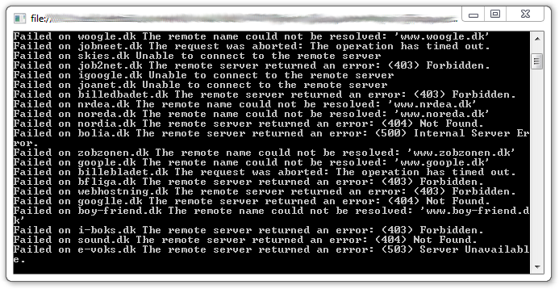
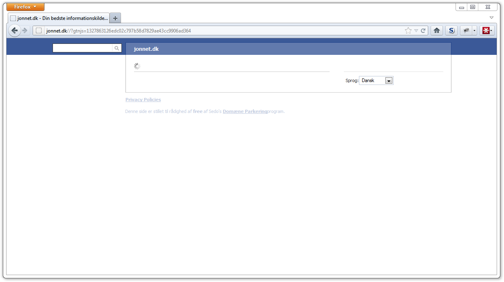

[Typosquatters](https://en.wikipedia.org/wiki/Typosquatting) are people that buy domains with a name
close to an existing domain. Usually the domain they squat is popular and therefore has a high risk
of people typing the wrong URL in their browser. Example:

**gooogle**.dk is a typosquat domain of **google**.dk

The problem with typosquatters is that they are hurting the domain they squat, by hijacking users.
Many typosquat domains also contain malware, advertisements and are used to do [black hat
SEO](https://web.archive.org/web/20130116034403/http://websearch.about.com/od/seononos/a/spamseo.htm) and otherwise hurt the user experience on
the Internet. In this blog post I'm going to create an automated procedure of reliably finding
typosquatters of .dk domains, and at the same time present the data found in the process of creating
this procedure.

## The Process

### 1. Finding Popular Domains

To begin with, I created a list of popular domain names ending in .dk. I used
[Alexa](https://web.archive.org/web/20120404144219/http://www.alexa.com:80/topsites/countries/dk) to get the list of domains as they have
filtering by country.

### 2. Filtering

Alexa provided not only .dk domains, but also .com domains. I removed all the .com domains, even
though many of them have .dk counterparts. I also removed all domains that had a length of 4 or less
as they would produce a lot of false-positives in the next step.

### 3. Finding Typosquat Domains

I used the [Damerau-Levenshtein
distance](https://en.wikipedia.org/wiki/Damerau%E2%80%93Levenshtein_distance) algorithm to find the
number of edits required between two domains. Having small domain names gave me a problem of too
many false-positives. a.dk would have a distance of 1 to b.dk, and b.dk is not a typosquat domain.

[{width="693" height="358" loading="lazy" decoding="async"}](https://en.wikipedia.org/wiki/Typosquatting)

A lot of the domains timed out or returned 404

Next I made a list of 862.000 active Danish domains by data-mining 4 different data-sources. The
reason I had to data-mine instead of getting a complete list from the dk
[TLD](https://en.wikipedia.org/wiki/TLD), is that [dk-hostmaster](https://punktum.dk/)
no longer provides the public with a full list of dk domains. According to their [statistics
page](https://stats.punktum.dk/domains), they have
1.156.476 domains, so the list I created is by no means complete.

### 4. Marking The Positives

Manually checking the results revealed that a lot of typosquat domains looked the same and had the
same layout. I saved the sites in a collection of their own, and if the distance to those sites was
below 20, I marked the site as a typosquat domain.

### 5. Marking The Negatives

I downloaded the HTML for all 100 popular sites and compared the results of all potential typosquat
domains to that HTML. If the distance was 50 or below, I marked the page as an alias (The owner of
the popular site typosquats his own domain to prevent others from doing it).

## The Results

A total of 746 potential typosquat domains were found by comparing the 100 popular sites to the
860.000 Danish domains. Out of those, 138 confirmed typosquat domains were found and 287 aliases
were found.

```chart
id: danish-domains
type: "bars"
title: "Investigated domains"
note: "Share of domains by classification"
decimals: 0
max: 100
data: [["Typosquat", 15], ["Ordinary", 53], ["Alias", 32]]
```

The following domain usernames were found in the process:

- DL4695-DK
- JT6619-DK
- HHL113-DK
- WA3375-DK
- DB7060-DK
- IM2838-DK
- KB11475-DK
- UIG3-DK
- DA13215-DK
- DB7120-DK
- DS11319-DK
- YX7-DK
- EOA89-DK
- MM18535-DK
- AAI56-DK
- HX23-DK
- LX17-DK
- FMI19-DK
- MK20537-DK
- NP1743-DK
- DA12540-DK
- JL10879-DK
- DL4843-DK
- IDF3-DK
- BBL46-DK
- IAL33-DK
- PT3833-DK
- T13205-DK
- VD1208-DK
- MM19124-DK
- JM11900-DK
- EL2826-DK
- S12017-DK
- NL1786-DK
- ELJM1-DK
- MM19927-DK
- AS20785-DK
- XQ1-DK
- MK17141-DK
- EH4651-DK
- XA441-DK
- XA440-DK
- EN1576-DK

Each username can be looked up [here](https://www.dk-hostmaster.dk/index.php?id=154). Doing so will
result in 3531 domains with a high concentration of typosquat domains.

## The Case Of Sedo

About 90% of the domains are owned by Sedo, a domain hosting company that advertises with the
ability of giving your site more traffic. They do so by linking the typosquat domains to your site.

Not only does Sedo use typosquat domains, they also buy popular domains that have been shut down or
have expired.

Their tactics are relentless, they even use designs of popular sites like Facebook as a way of
tricking users. They also use different designs with content related text on their typosquat domains
to lure people into clicking on their links.

{width="1237" height="694" loading="lazy" decoding="async"}

Typosquat site owned by Sedo

## Notes

A lot of the sites that are on the [typosquat
list](https://www.dk-hostmaster.dk/klager-og-suspension/suspension/typosquatting/klager-og-afgoerelser/) (link unavailable)
created by dk-hostmaster are the very same domains I found in my analysis. Even though they have closed
a lot of sites belonging to the [same
username](https://www.dk-hostmaster.dk/index.php?id=42&query=DS11319-DK&submit=S%F8g&ar=1)
(DS11319-DK), they do not close the account or otherwise punish the typosquatters.