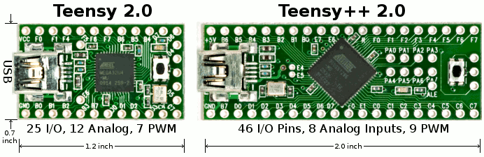

In this day and age, attacking computers using physical devices has, contrary to popular belief,
followed a linear growth in the field of penetration testing. Back in the day when Windows 95
introduced the 'autorun' feature, hackers began to use it as a means of installing malicious
software on their victims’ PCs. Today, the auto-run feature has been disabled, however, we still have
various means of executing applications automatically.

{width="692" height="225" loading="lazy" decoding="async"}

One of the more popular ways of doing this, is to emulate a keyboard using a [Teensy
board](https://www.pjrc.com/teensy/). However, lately the [Rubber
Ducky](https://hakshop.myshopify.com/products/usb-rubber-ducky) has gotten some attention, so I
decided to buy a few to test them out.

Suffice to say that it is not what has been advertised. It functions merely as a prank device rather
than a part of a penetration testing toolkit. A poorly made scripting language, lack of support and
limited functionality reduce the device to a useless, but pretty laptop ornament for the wealthy
hacker. I would recommend everyone to buy the Teensy board, as the Teensy is way more powerful,
cheaper, more stable and has a ton of features, compared to the cash cow that the Hak5 team
calls 'Rubber Ducky'.