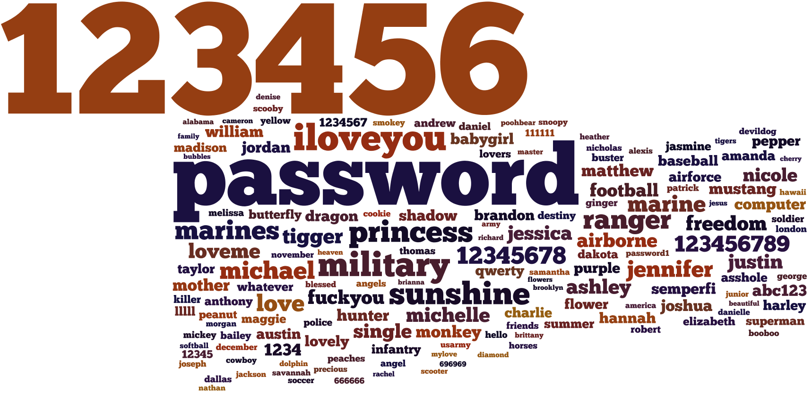

This time I take a look at an interesting leak: MilitarySingles.org. They are operated by ESingles
Inc. and they claimed that they had not been hacked by the notorious LulzSec hacker group. They
assured their customers that the site had not been hacked and they claimed that " *All user
passwords in our database are encrypted and secure.*". The rest of the story can be seen at
[databreaches.net](http://www.databreaches.net/?p=23736).

It turns out that the passwords, despite what ESingles said, were not encrypted nor secure. They are
unsalted MD5 hashes and combined with a weak password policy, almost all of the hashes were cracked
within a few minutes.

A total of 163.792 hashes were leaked and 151.791 (92.2%) of them were cracked in 9 hours.

## The Results

### Length distribution

```chart
id: militarysingles-length
# The original chart labelled only the first 8 columns, as 1 to 8; lengths 3 to 12 match the average of 7.427 given in the post.
type: columns
note: "Share of cracked passwords"
x_label: "Characters"
max: 30
data: [[3, 0.21], [4, 2.66], [5, 3.88], [6, 26.21], [7, 19.54], [8, 25.60], [9, 11.70], [10, 6.34], [11, 2.22], [12, 1.00]]
```

Average password length: 7,427

### Character distribution

```chart
id: militarysingles-characters
type: "bars"
note: "Share of character types across all passwords"
decimals: 0
max: 100
data: [["Lowercase letters", 60], ["Uppercase letters", 5], ["Symbols", 1], ["Digits", 34]]
```

### Unique character distribution

```chart
id: militarysingles-combinations
type: "bars"
note: "Share of passwords using only these characters"
max: 100
data: [["Lowercase only", 47.54], ["Uppercase only", 1.31], ["Symbols only", 0.01], ["Digits only", 9.03], ["Alphanumeric only", 98.75]]
```

### Contained in common wordlists

```chart
id: militarysingles-wordlists
type: "split"
note: "Share of cracked passwords"
decimals: 0
data: [["In wordlists", 69], ["Not in wordlists", 31]]
```

### Contained in IQ wordlist ([Click here for more info](/2012/01/building-perfect-wordlist.html))

```chart
id: militarysingles-iq
type: "split"
note: "Share of cracked passwords"
decimals: 0
data: [["In IQ wordlist", 83], ["Not in IQ wordlist", 17]]
```

### Top 30 most common passwords

| Password  | Frequency |
|-----------|-----------|
| 123456    | 763       |
| password  | 415       |
| iloveyou  | 177       |
| military  | 165       |
| sunshine  | 152       |
| princess  | 146       |
| ranger    | 131       |
| marines   | 128       |
| michael   | 118       |
| 12345678  | 118       |
| love      | 113       |
| marine    | 110       |
| 123456789 | 110       |
| jennifer  | 109       |
| tigger    | 100       |
| loveme    | 99        |
| freedom   | 98        |
| michelle  | 97        |
| ashley    | 97        |
| justin    | 95        |
| single    | 94        |
| jessica   | 94        |
| airborne  | 93        |
| fuckyou   | 93        |
| nicole    | 89        |
| football  | 87        |
| 1234      | 82        |
| matthew   | 81        |
| monkey    | 81        |

### Top 30 longest passwords

| Password        | Length |
|-----------------|--------|
| chocolatemint12 | 15     |
| iloveallmy4kids | 15     |
| Septembergirl13 | 15     |
| restoration2010 | 15     |
| alwayslovingyou | 15     |
| salveregina1988 | 15     |
| plastickitten58 | 15     |
| 123456789101112 | 15     |
| screamingeagles | 15     |
| whiskeygirl2012 | 15     |
| pharmaceuticals | 15     |
| philippines2012 | 15     |
| catherine102484 | 15     |
| airforcegirl711 | 15     |
| loveme163456123 | 15     |
| schoolofrock123 | 15     |
| hannahjones1989 | 15     |
| youllneverguess | 15     |
| ctxcolormonitor | 15     |
| flexiblecouch10 | 15     |
| 1cutestrawberry | 15     |
| destinyschild20 | 15     |
| coloradosprings | 15     |
| rockfordfosgate | 15     |
| americansingles | 15     |
| danielradcliffe | 15     |
| kimberly1234567 | 15     |
| Fuckyourself007 | 15     |
| POPOCATEPEL1978 | 15     |

### Bonus: Visualization of the common passwords

{width="1718" height="834" loading="lazy" decoding="async"}