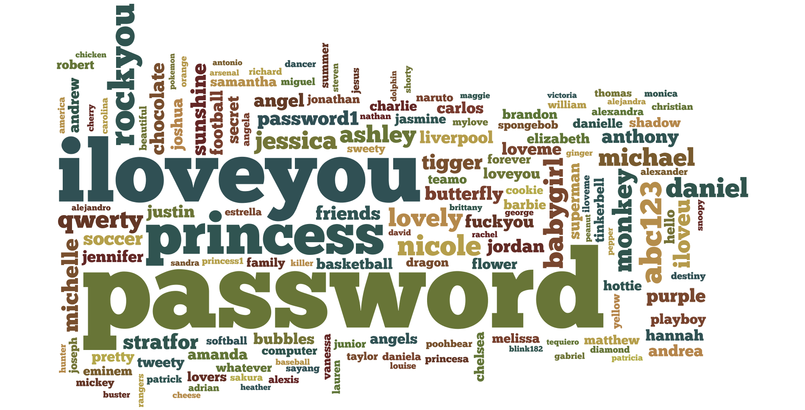
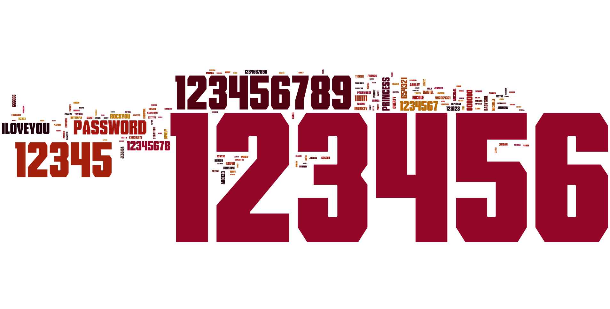

Some time ago I posted a visualization of the [most used
passwords](/2012/01/most-used-passwords-visualized.html). To continue the
success, I will post a new one based on 33.954.491 passwords, about 30 times the amount of the
previous visualization.

{width="1900" height="970" loading="lazy" decoding="async"}

Because of the large amount of numeric passwords, I had to make a visualization with, and without
numbers. Here is the one with numbers.

{width="1908" height="970" loading="lazy" decoding="async"}

It is pretty clear that **123456** is the most used password. Right-click the images and choose
"View Image" to see a larger version.