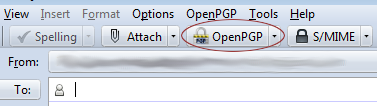
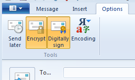

A friend of mine recently asked how PGP email encryption works, and I remember how hard it was for
me to understand how it all works, so I decided to write this guide to email security.

**If you just need to know how to sign and encrypt emails, go to headline 3.1 to use OpenPGP or
headline 3.4 to use S/MIME**

## 1. Email Security - An Overview

Whenever you write an email, it is sent to the receiver in clear text. Email services like Gmail
support TLS (Transport Layer Security) that encrypts the message in transition, but the email is
still stored in clear text on the end user’s machine. In information security, we have something
called the [CIA triad](https://en.wikipedia.org/wiki/Information_security#Key_concepts) that consists
of 3 areas: Confidentiality, Integrity and Availability. In this post, we will only focus on the
first 2 areas, and we will start with a subsection of integrity called authenticity.

### 1.1 Email Authenticity

When you receive an email from someone, how can you be sure of the following:

1. The email was not altered in transition.
2. The email was sent from the right person.

With ordinary emails, you can't be sure of either 1 or 2. A hacker intercepting the message using
[MitM attacks](https://en.wikipedia.org/wiki/Man-in-the-middle_attack) or a rogue network
administrator might have altered the message in transition. Spammers are also known for using
[spoofed](https://en.wikipedia.org/wiki/Forgery) email addresses to get their message out to people.
They might write advertising@target.com as the sender of the email to make the message more
effective.

This is where [digital signatures](https://en.wikipedia.org/wiki/Digital_signature) come in. We can
solve both problems by signing our emails using [asymmetric cryptographic
keys](https://en.wikipedia.org/wiki/Public-key_cryptography), also known as public/private keys.

### 1.2 Public/Private keys

Using some clever math and cryptographic functions, we can create 2 keys that have different
functionality. The keys are used differently depending on what you are trying to achieve. When we
are signing a message, we keep one key to ourselves (the private key) and send the other key (the
public key) to anyone that needs to verify our email.

<figure class="diagram diagram-panel signature-diagram" role="img" aria-label="Alice signs the message I will pay $500 using her private key. She sends the message and signature to Bob. Bob verifies them using Alice's public key, producing a valid or invalid result. Signing does not encrypt the message.">
    

        

            
AliceSender

            

                
<small>Message</small>I will pay $500

                
<small>Kept secret</small>Alice’s private key

            

            
↓

            
Sign<small>Produce a digital signature</small>

        

        
Send message + signature ↓

        

            
BobReceiver

            

                
<small>Received</small>Message + signature

                
<small>Trusted as Alice’s</small>Alice’s public key

            

            
↓

            
Verify<small>Result: valid or invalid</small>

        

    

    <figcaption aria-hidden="true">Signing protects authenticity and integrity. It does not hide the message’s contents.</figcaption>
</figure>

A signature algorithm uses your private key to sign the message, typically through a
[cryptographic hash](https://en.wikipedia.org/wiki/Cryptographic_hash_function) of its contents.
The message and signature are sent together. The receiver verifies the signature against the
received message using your public key.

If the message or signature has been altered, verification fails. Successful verification shows
that the signature matches the message and public key. To attribute it to you, the receiver also
needs to trust that the public key belongs to you. As [NIST explains](https://csrc.nist.gov/glossary/term/digital_signature),
digital signatures provide authenticity and integrity; signing does not encrypt the message.

### 1.3 Email Confidentiality

Encryption serves a different purpose: it hides the contents of an email so that only the intended
receiver can read it. This time we need to get the public key of the receiver of the email before we send the
email. We simply encrypt the email using the receiver’s public key, and only the receiver with the
private key can decrypt the message.

Remember that encrypting the email using the public key of the receiver does not prove the
authenticity of the email, but merely makes it unreadable to everyone else. If we need both
authenticity and confidentiality, we need to both sign and encrypt the email.

## 2. The Security Standards

When it comes to email security, we have 2 major standards competing on the market.

- OpenPGP
- S/MIME

### 2.1 OpenPGP

OpenPGP stands for Open Pretty Good Privacy and is a format based on the original PGP format. It
uses its own standard for describing encrypted email content. OpenPGP supports signatures using algorithms such as DSA or RSA, public-key encryption using RSA or
[ElGamal](https://en.wikipedia.org/wiki/ElGamal), and message encryption using symmetric algorithms
such as [TripleDES](https://en.wikipedia.org/wiki/3des) or AES. The format is sent
over the Internet using multipart/encrypted [MIME](https://en.wikipedia.org/wiki/MIME) format. It is
widely supported by the open source community and has been built into a bunch of mail applications,
most notably the Mozilla Thunderbird client with the Enigma plugin.

### 2.2 S/MIME

S/MIME stands for Secure/Multipurpose Internet Mail Extensions, and while it does the same thing as
OpenPGP, the two formats are in no way interoperable and messages created in one format can't be
read in the other. S/MIME supports signatures using algorithms such as DSA or
[RSA](https://en.wikipedia.org/wiki/RSA_%28algorithm%29), key agreement using
[Diffie-Hellman](https://en.wikipedia.org/wiki/Diffie-Hellman), and message encryption using symmetric
algorithms such as TripleDES or AES.
The MIME format is application/pkcs7-mime and in most email clients that do not understand the
format, you will get an attachment called 'smime.p7m' that contains the signed and/or encrypted
email.

### 2.3 The Format Problem

OpenPGP and S/MIME use different formats for signing and encrypting messages, and thus, they need
different applications. The lack of traction in the general population of Internet users, means that
there are only a few good tools out there that give us email signing and encryption for free. Most
tools only support one of the two protocols and most popular online email providers do not support
either of the two.

The biggest differences between the two formats are the concepts on which they are built. OpenPGP is
built on the [WOT](https://en.wikipedia.org/wiki/Web_of_trust) concept, a distributed approach to
sharing keys, while S/MIME is built on [PKI](https://en.wikipedia.org/wiki/Public_key_infrastructure)
a centralized key sharing concept. The biggest difference between the two concepts is that PKI
relies on a Certification Authority (CA) that signs the keys. Everyone trusts the CA, and so all the
keys the CA signs are trusted. However, in order to get your key signed by a CA, you need to pay a
third party CA. In OpenPGP there is no such thing as a CA and each user can sign another user’s key
to endorse the binding between the key and the user. It is all a matter of trust, but it becomes
important when you need to make sure that the public key of a user is the right public key, and not
one a hacker made to impersonate a user.

## 3. The Practical Approach

Now that we know what we need to get us going, let's take a look at how to implement digital
signatures using both OpenPGP and S/MIME.

### 3.1 OpenPGP Setup

GnuPG stands for GNU Privacy Guard and it supports both OpenPGP and S/MIME in the latest versions
(since 2.0). Gpg4Win is a Windows port of the application that can be [found
here](https://gpg4win.org/).  
To create an OpenPGP certificate, do the following:

1. [Download](https://gpg4win.org/download.html) the Gpg4Win full installation and install it
2. Open Kleopatra, go to *File*-\>*New Certificate* and click "Create a personal OpenPGP key pair"
3. Enter name and email, click *Next*.
4. Make sure the information is correct. Click *Create Key*.
5. Enter a [secure](https://www.grc.com/haystack.htm) pass phrase. Security is indicated by the
   green bar.
6. Click *Finish*.

Now you have a certificate with a public/private key pair.

### 3.2 Using OpenPGP with Mozilla Thunderbird

Mozilla Thunderbird supports S/MIME out of the box, but does not support OpenPGP. In order to get
that support, you will have to use Enigmail. Here is how you set up OpenPGP in Thunderbird:

1. [Download](https://www.enigmail.net/) and install Enigmail. **Note:**
   You can do this from inside Thunderbird. Click *Tools*-\> *Add-ons* and install Enigmail.
2. Open Thunderbird and right-click on the account you would like to use OpenPGP with and click *Settings*.
3. Find the "OpenPGP Security" settings and check the box in "Enable OpenPGP support (Enigmail) for
   this identity".
4. Click *Select Key* and choose the key you created earlier in Kleopatra.

{width="377" height="106" loading="lazy" decoding="async"}

Whenever you write an email, you will get some options in the toolbar with OpenPGP. There you can
select whether to sign or encrypt the email. It is that simple to get OpenPGP going in Mozilla
Thunderbird.

### 3.4 S/MIME Setup

In order to get email signing and encryption with S/MIME, we need a digital signature. Mozilla has a
[great article](https://kb.mozillazine.org/Getting_an_SMIME_certificate) that lists the sites where
you can get a free certificate. Scroll down to "Self-signed certificates" to see how you can create
one yourself. An alternative is to use [Mobile
Fish](https://www.mobilefish.com/services/ssl_certificates/ssl_certificates.php), which is what I did
with this guide.

1. Go to [Mobile Fish](https://www.mobilefish.com/services/ssl_certificates/ssl_certificates.php)
2. Enter Country, State name, Locality name and Common name. Press the question mark next to the
   item to show more info about the field.
3. Enter your email in the email field. Note: This email has to be the email you wish to give a
   digital signature.
4. Set the pass-phrase to something [secure](https://www.grc.com/haystack.htm).
5. Set the bit length to 1024 or more
6. Set the number of days to 365
7. Click *Generate*

Now you should be presented with a bunch of fields. You need to download the following:

- The Self-Signed SSL Certificate - Name it selfsigned.cert
- The Private Key - Name it private.key
- The Public Key - Name it public.key

Now we have a certificate, but in order for Windows to use it, we need to convert it to the PFX
format. Here is how you do it:

1. Download the [OpenSSL library for Windows](https://slproweb.com/products/Win32OpenSSL.html)
   (Direct link: [Win32 OpenSSL v1.0.1c
   Light](https://web.archive.org/web/20121019130525/http://slproweb.com/download/Win32OpenSSL_Light-1_0_1c.exe))
2. Install the library with standard settings.
3. Copy the 3 files (private.key, public.key and selfsigned.cert) to the
   'C:\\OpenSSL-Win32\\bin' folder
4. Go to the Start menu, enter 'cmd' in the search and press *Enter*.
5. Write 'cd C:\\OpenSSL-Win32\\bin' and press *Enter*.
6. Write 'openssl pkcs12 -inkey private.key -in selfsigned.cert -export -out mycert.pfx' and press *Enter*.
7. You should now be prompted with the private key password and an export password. Enter the same
   password you chose on Mobile Fish.
8. You should now have a mycert.pfx inside the
   'C:\\OpenSSL-Win32\\bin' folder.

### 3.5 Using S/MIME in Windows Live Mail

Windows Live Mail uses the Certificate Store inside Microsoft Windows. The easiest way to use a
certificate in Windows Live Mail is to simply double-click the mycert.pfx file inside
'C:\\OpenSSL-Win32\\bin' and follow the wizard. When you get
prompted with a password, enter the private key password.

**Note:** If you are using a self-signed certificate, you need to run the wizard one more time. This
time, when you get to the wizard page where you choose the Certificate Store, select "Trusted Root
Certification Authorities". This is necessary as you have no third party CA that signed the
certificate, otherwise the certificate will not work!

Now that the certificate is installed, you only need to associate it with your Windows Live Mail
account.

1. Open Windows Live Mail
2. Right-click the account with the email that is in the certificate and click *Properties*.
3. Go to the *Security* tab and click the *Select* button under "Signing certificate". The
   certificate you just installed should be selected. Do the same with the "Encrypting preferences"
   if Windows Live Mail did not do it for you already.

{width="273" height="162" loading="lazy" decoding="async"}

Whenever you write an email in Windows Live Mail, you can go to the *Options* tab and select
*Encrypt* and *Digitally Sign*. When you send the email, it will be encrypted and signed.

### 3.6 Using S/MIME in Thunderbird

Thunderbird uses the Mozilla Certificate Store, so we need to import the certificate into that
store.

**Note:** If the certificate is self-signed, you need to follow [this short
guide](https://kb.mozillazine.org/Installing_an_SMIME_certificate#Installing_a_Self-Signed_SMIME_Certificate_for_Your_Own_Identity)
first.

1. Open Thunderbird, go to *Tools* -\> *Options* -\> *Advanced* -\> *Certificates* -\> *View
   Certificates*.
2. Under the "Your Certificates" tab, click on *Import*.
3. Select the "mycert.pfx" file inside the
   'C:\\OpenSSL-Win32\\bin' folder.
4. Enter the private key password.
5. Click *OK*.

Now you only need to associate the certificate with the account.

1. Open Thunderbird, right-click on the account you want to use.
2. Click *Settings* and go to the "Security" properties.
3. Click *Select* next to "Digital Signing" and select your certificate.
4. When it asks you to use the same certificate for encryption, click *Yes*.
5. Click *OK*.

Now you have S/MIME encryption in Thunderbird.

### 3.7 Using S/MIME in Gmail

Gmail does not have native S/MIME support even though there have been countless requests by
concerned users. One might argue that the end-to-end encryption concept will break if Gmail is
responsible for decrypting the messages, but it would heighten the security nonetheless.

If you are running Firefox, you can try the [Penango plugin](https://web.archive.org/web/20120717022655/http://www.penango.com:80/pricing.shtml),
it is free for Gmail and Firefox users. Firefox uses the Mozilla Certificate Store, the same as
Thunderbird, so if you are using Thunderbird and Firefox together, Penango will make it seamlessly
work together.

## 4. Notes

### 4.1 Windows Live Mail does not list any certificates

Make sure that the email inside the certificate is identical to the account you are trying to bind
with. Also make sure that the certificate is trusted by a CA. If the certificate is self-signed, add
the certificate to the Trusted Certificate Authority certificate store on your computer.

### 4.2 Penango tells me that the email is unreliable

This is because Penango uses S/MIME that is based on the PKI. If your certificate is not trusted by
a third party, it will give you a warning telling you that the certificate is self-signed or not
issued by a trusted CA.

### 4.3 My application is not described

A lot of applications have S/MIME support, however, if your favorite mail application does not
support S/MIME and you get the smime.p7m attachment, you can just use the
[p7mViewer](https://web.archive.org/web/20130617114938/http://www.cryptigo.eu/p7mViewer/).

### 4.4 OpenPGP for Apple

If you are using a Mac, you can install a [plugin to Apple
Mail](https://gpgtools.org/gpgmail/index.html) that enables OpenPGP support.

### 4.5 OpenPGP for Gmail in Chrome

A research team have implemented OpenPGP as JS in the form of a [Chrome
extension](https://web.archive.org/web/20130127210854/http://gpg4browsers.recurity.com:80/). It is called GPG4Browsers and advertises support for
OpenPGP in Gmail.

### 4.6 OpenPGP in Outlook

If you are using Outlook 2010, you might want to try out the [Outlook Privacy
Plugin](https://github.com/Meddington/OutlookPrivacyPlugin).