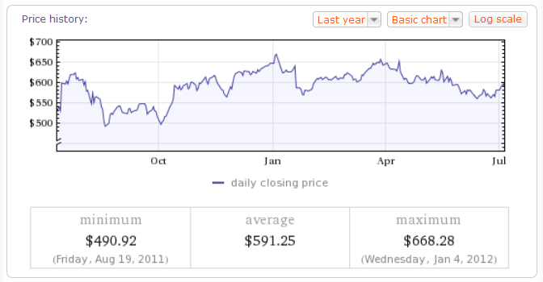

In an ongoing project of mine, I needed access to a good source of information that is free,
powerful and provides some sort of API. My first thought was on
[Wolfram\|Alpha](https://www.wolframalpha.com/), a powerful search engine that has thousands of
databases filled with useful information and a really great interpreter that tries to guess what you
mean by the [22nd president of the
USA](https://www.wolframalpha.com/input/?i=22th+president+of+the+USA). If you have not yet tried
Wolfram\|Alpha, I highly encourage you to take a look at it.

 {width="672" height="350" loading="lazy" decoding="async"}

*The results from Wolfram\|Alpha when looking up "Google stock"*

Wolfram\|Alpha has a REST based API that outputs beautiful XML data ready to parse. They really put
some work into making it easy to use, so I thought it would be a no-brainer to find an existing C#
library that would parse it and give me objects that I could work with. However, it turns out that
there are only a few of them, and only a fraction of those support the 2.0 API that Wolfram\|Alpha
[introduced](https://blog.wolframalpha.com/2011/01/20/knowledge-based-computing-and-version-20-of-the-wolframalpha-api/)
back in January 2011. I decided to code an API myself that could be easily extended with new
features and would provide me with the full API.

I present to you, the all new [WolframAlpha.net API](https://github.com/Genbox/WolframAlpha).
It is based on the open source [RestSharp](https://github.com/restsharp/RestSharp) framework for
parsing the XML data, so a big thanks goes out to the guys behind it for an awesome job.